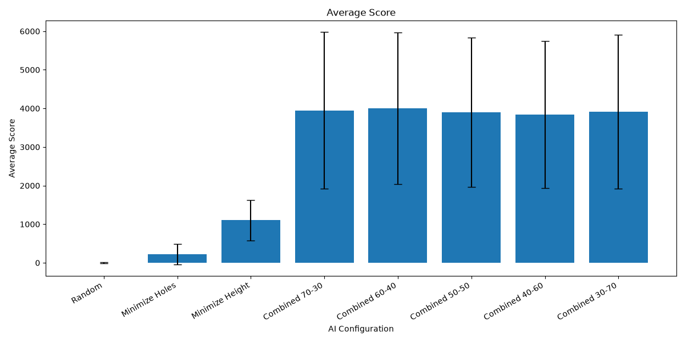
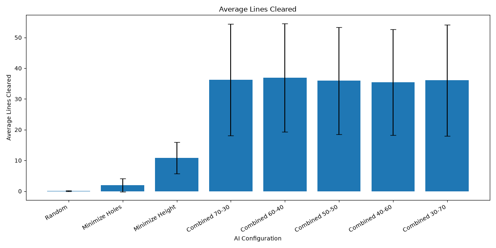
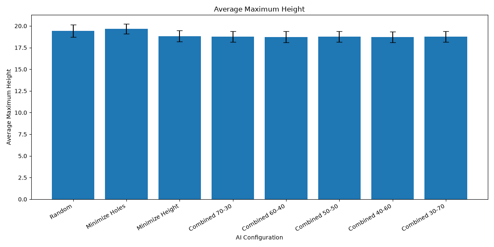
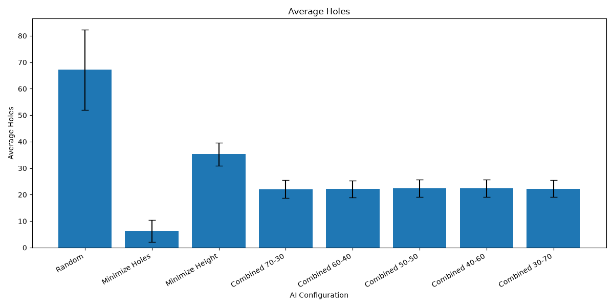

# OkState-ECEN4293-Final_Project

## Abstract

This project investigates the use of numerical optimization strategies to improve automated gameplay in Tetris. A Python-based Tetris game was developed using NumPy for board representation and Matplotlib for the graphical interface. Four automated strategies were implemented: random placement, hole minimization, height minimization, and combined optimization. Eight configurations were evaluated through 8,000 simulated games. The combined optimization strategies substantially outperformed the individual strategies, with the 60/40 hole-to-height weighting producing the highest average score of 4,003.30 points. The results generally matched the expectation that combining multiple placement objectives would produce better gameplay than optimizing for only one objective.

## 1. Introduction

Tetris is a puzzle game in which differently shaped blocks, called tetrominos, fall onto a rectangular playing board. The objective is to arrange the tetrominos to complete horizontal rows. Completed rows are removed from the board, creating space for additional tetrominos. The game ends when the stack of tetrominos reaches the top of the board and another tetromino can no longer be placed.

Although the rules are relatively simple, selecting good placements requires evaluating how each decision affects the remaining board. A placement that appears beneficial in the short term may create empty spaces underneath other blocks or increase the overall height of the stack. These problems make Tetris a useful environment for studying automated decision-making and optimization.

Previous research has investigated several approaches to automated Tetris gameplay. Thiery and Scherrer reviewed Tetris controllers and discussed how evaluation features and their weights influence performance. Their work also emphasizes that comparisons between Tetris algorithms must account for variation in results and differences in implementation [1]. Szita and Lőrincz investigated the use of the noisy cross-entropy method to optimize Tetris gameplay, demonstrating another approach to improving automated placement decisions [2].

This project uses a more direct approach. Rather than training an AI through reinforcement learning or another learning algorithm, the program evaluates possible legal placements using measurable board characteristics. The project investigates whether combining two objectives—minimizing holes and minimizing board height—can produce better results than optimizing for either objective independently.

The main objectives were to:

- Develop a functional Tetris game using Python.
- Implement all seven standard tetrominos and their rotations.
- Provide both human-controlled and automated gameplay.
- Develop four automated placement strategies.
- Compare the performance of the strategies through repeated simulations.
- Investigate how different optimization weights affect automated gameplay.

## 2. Detailed Design

### 2.1 Program Structure

The project was organized into separate modules to keep the game mechanics, graphical interface, automated strategies, and simulation experiments independent.

| File | Purpose |
|---|---|
| `game/main.py` | Starts the playable game and manages user interaction |
| `game/board.py` | Defines the board and placement validation |
| `game/tetrominos.py` | Defines the seven tetromino shapes |
| `game/game_engine.py` | Handles gameplay, movement, rotation, scoring, and line clearing |
| `game/GUI.py` | Displays the game using Matplotlib |
| `game/automation.py` | Contains the automated placement strategies |
| `experiments/run_sim.py` | Runs the automated simulation experiments |
| `experiments/analyze_results.py` | Calculates statistics and generates comparison graphs |

The game board is represented using a NumPy array with 20 rows and 10 columns. This design allows the program to efficiently check occupied cells, validate placements, and identify completed rows.

The game mechanics are separated from the graphical interface so that the same game engine can be used for both interactive gameplay and automated simulations. This also prevents the simulation program from needing a separate implementation of the Tetris rules.

### 2.2 Legal Placement Evaluation

Before an AI strategy can select a placement, the program identifies all legal placements for the current tetromino.

Each unique rotation is evaluated across the available board columns. Duplicate rotations are removed so that symmetrical tetrominos do not produce unnecessary repeated evaluations.

For each rotation and column, the program determines the lowest valid row where the tetromino can land without overlapping existing blocks or exceeding the board boundaries.

The resulting placements are evaluated by the selected AI strategy.

**Legal placement pseudocode:**

```text
GET ALL LEGAL PLACEMENTS

1. Generate all unique rotations of the active tetromino.
2. Create an empty list of legal placements.
3. For each unique rotation:
   a. Check each available column.
   b. Start at the top of the board.
   c. If the placement is invalid, skip the column.
   d. Otherwise, move the tetromino downward
      until the next downward movement is invalid.
   e. Save the rotation, final row, and column.
4. Return the list of legal placements.
```

### 2.3 Automated Optimization Strategies

Four automated strategies were implemented. Each strategy uses the same legal placement evaluation process but selects a placement using a different objective.

#### 2.3.1 Random Placement

The random strategy selects one placement randomly from the list of legal placements.

This strategy provides a baseline for comparison. It demonstrates how the game performs without evaluating the quality of individual placements.

#### 2.3.2 Hole Minimization

The hole minimization strategy selects the placement that produces the fewest holes in the board.

A hole is defined as an empty cell located underneath an occupied cell in the same column. Holes are undesirable because they can become difficult to fill with future tetrominos.

For each possible placement, the program copies the current board, simulates the placement, clears any completed rows, and counts the remaining holes.

The placement with the lowest hole count is selected.

**Hole minimization pseudocode:**

```text
MINIMIZE HOLES

1. Generate all legal placements.
2. Set the best hole count to infinity.
3. For each legal placement:
   a. Copy the current board.
   b. Simulate the placement on the copied board.
   c. Remove any completed rows.
   d. Count the holes in the resulting board.
   e. If the hole count is lower than the best count:
      Save this placement as the best placement.
4. Return the best placement.
```

#### 2.3.3 Height Minimization

The height minimization strategy selects the placement that produces the lowest overall occupied board height.

The board height is calculated by finding the first row containing an occupied cell and subtracting its row index from the total number of rows.

For each legal placement, the program simulates the placement, clears completed rows, and calculates the resulting board height.

The placement producing the lowest calculated height is selected.

This strategy attempts to prevent the stack from building too close to the top of the board.

#### 2.3.4 Combined Optimization

The combined strategy evaluates both the number of holes and the overall board height.

Since these measurements use different numerical ranges, both are normalized before being combined.

The combined evaluation function is:

\[
S =
w_h\left(\frac{H}{200}\right)
+
w_b\left(\frac{B}{20}\right)
\]

Where:

- \(S\) = Combined evaluation score
- \(w_h\) = Hole minimization weight
- \(w_b\) = Height minimization weight
- \(H\) = Number of holes
- \(B\) = Overall board height

The normalization values come from the board dimensions: 200 total cells and 20 rows.

The weights determine how much importance the AI assigns to each objective. A lower combined evaluation score represents a more desirable placement.

The program evaluates every legal placement and selects the one with the lowest combined score. If multiple placements have the same score, one is selected randomly.

### 2.4 Combined Optimization Configurations

Five different weight combinations were tested to investigate how the relative importance of holes and height affected performance.

| Configuration | Hole Weight | Height Weight |
|---|---:|---:|
| Combined 70-30 | 70% | 30% |
| Combined 60-40 | 60% | 40% |
| Combined 50-50 | 50% | 50% |
| Combined 40-60 | 40% | 60% |
| Combined 30-70 | 30% | 70% |

The individual random, hole minimization, and height minimization strategies were also included, producing eight total configurations.

### 2.5 Simulation Design

The simulation program runs independently of the graphical interface. It uses the same game engine and automated strategy functions as the playable game.

Each simulation creates a new game and allows the selected AI strategy to continue making placements until the game ends.

The program records four measurements:

1. **Score:** Total points earned during the game.
2. **Lines Cleared:** Total number of completed rows removed.
3. **Maximum Height:** Greatest overall occupied board height reached during the game.
4. **Remaining Holes:** Number of holes present when the game ends.

A total of 1,000 games were run for each configuration.

A fixed random seed of 42 was used to make the overall simulation run reproducible.

## 3. Results

### 3.1 Project Implementation

The finished project includes a playable Tetris game with human-controlled and automated gameplay. Users can select an automated strategy and observe the AI making placements through the graphical interface.

The automated strategies were also integrated into a separate simulation program. This allowed thousands of games to be evaluated without needing to display every game through the graphical interface.

The project requirements were addressed as follows:

| Requirement | Result |
|---|---|
| Implement a 20-by-10 Tetris board | Completed |
| Implement seven standard tetrominos and rotations | Completed |
| Implement a graphical interface | Completed |
| Support human-controlled gameplay | Completed |
| Support automated gameplay | Completed |
| Implement four automated strategies | Completed |
| Test five combined optimization weight configurations | Completed |
| Run 1,000 games per configuration | Completed |
| Collect four performance measurements | Completed |
| Generate statistical summaries and comparison graphs | Completed |

### 3.2 Quantitative Simulation Results

A total of 8,000 games were simulated across the eight configurations.

The following table presents the average results for each configuration.

| Configuration | Average Score | Average Lines Cleared | Average Maximum Height | Average Remaining Holes |
|---|---:|---:|---:|---:|
| Random | 2.30 | 0.02 | 19.42 | 67.17 |
| Minimize Holes | 224.50 | 1.97 | 19.68 | 6.28 |
| Minimize Height | 1,104.50 | 10.84 | 18.82 | 35.29 |
| Combined 70-30 | 3,945.40 | 36.26 | 18.76 | 22.09 |
| Combined 60-40 | **4,003.30** | **36.91** | 18.73 | 22.18 |
| Combined 50-50 | 3,899.20 | 35.92 | 18.75 | 22.38 |
| Combined 40-60 | 3,842.90 | 35.44 | **18.71** | 22.43 |
| Combined 30-70 | 3,910.60 | 36.09 | 18.75 | 22.23 |

### 3.3 Graphical Results

The following graphs compare the average performance of the eight configurations.

**Average Score**



**Average Lines Cleared**



**Average Maximum Height**



**Average Remaining Holes**



### 3.4 Results Discussion

The results show that the combined optimization strategies substantially outperformed the individual strategies.

The random strategy performed the worst, averaging only 2.30 points and clearing 0.02 lines per game. This demonstrates the disadvantage of selecting placements without evaluating their effect on the board.

The hole minimization strategy averaged 224.50 points and cleared 1.97 lines per game. It produced the fewest remaining holes among the individual strategies, averaging 6.28. However, minimizing holes alone did not produce the highest scores.

The height minimization strategy performed better in terms of score and lines cleared, averaging 1,104.50 points and 10.84 lines per game. It was more successful than hole minimization at maintaining overall gameplay performance, but it left an average of 35.29 holes.

The combined strategies achieved the strongest overall results. The 60/40 configuration produced the highest average score of 4,003.30 and cleared the most lines, averaging 36.91 per game.

The 70/30 configuration produced the fewest remaining holes among the combined strategies, while the 40/60 configuration produced the lowest average maximum height among the combined strategies.

These results suggest that balancing multiple objectives is more effective than focusing on only one. The 60/40 configuration provided the best average score, although its advantage over the other combined configurations was relatively small compared with the variation between individual games.

The results also demonstrate that the best configuration depends on the performance measurement being considered. The configuration with the highest score was not necessarily the configuration with the fewest holes or lowest maximum height.

### 3.5 Limitations

There are several limitations to the current implementation.

First, the AI evaluates the immediate result of a placement rather than predicting several future tetromino placements. A placement that looks good immediately may create problems for future decisions.

Second, the height measurement considers the overall occupied height of the board rather than evaluating the height of each individual column. This provides a simple measurement but does not describe the entire shape of the stack.

Third, the hole measurement records the number of holes remaining at the end of a game rather than the total number of holes created throughout the game.

Finally, the standard deviations of the combined strategies are relatively large compared with the differences between their average scores. Therefore, the highest average score does not necessarily establish that one combined configuration is statistically superior to all the others.

## 4. Conclusion

The project was successful in developing a playable Tetris game and implementing multiple automated optimization strategies. The simulation program successfully evaluated eight configurations over 8,000 games and generated statistical summaries and graphical comparisons.

The most important result was that combining hole minimization and height minimization produced substantially better average performance than either strategy alone. The combined 60/40 configuration achieved the highest average score and the highest average number of lines cleared.

If the project were developed further, several improvements could be explored.

One improvement would be to evaluate additional board characteristics, such as column height differences, surface roughness, and the number of completed or nearly completed rows. These measurements could provide a more complete evaluation of the board.

Another improvement would be to implement lookahead evaluation. Instead of considering only the current tetromino, the AI could evaluate how a placement affects possible future placements.

The project could also investigate additional optimization weights and compare their results over a larger number of simulations. Statistical tests could be added to determine whether observed differences between configurations are meaningful.

Overall, the project demonstrated that numerical optimization can improve automated Tetris gameplay and that combining multiple evaluation criteria can produce better results than optimizing for a single objective.

## References

[1] C. Thiery and B. Scherrer, "Building Controllers for Tetris," *ICGA Journal*, vol. 32, no. 1, 2009. doi: [10.3233/ICG-2009-32102](https://doi.org/10.3233/ICG-2009-32102).

[2] I. Szita and A. Lőrincz, "Learning Tetris Using the Noisy Cross-Entropy Method," *Neural Computation*, vol. 18, no. 12, pp. 2936–2941, 2006. doi: [10.1162/neco.2006.18.12.2936](https://doi.org/10.1162/neco.2006.18.12.2936).

## Appendix A: Running the Project

Install the required dependencies:

```bash
pip install -r requirements.txt
```

Run the playable game:

```bash
python -m game.main
```

Run the simulation experiments:

```bash
python -m experiments.run_sim
```

Analyze the simulation results and generate graphs:

```bash
python -m experiments.analyze_results
```

## Appendix B: Project Structure

```text
OkState-ECEN4293-Final_Project/
│
├── game/
│   ├── main.py
│   ├── board.py
│   ├── tetrominos.py
│   ├── game_engine.py
│   ├── GUI.py
│   └── automation.py
│
├── experiments/
│   ├── run_sim.py
│   ├── analyze_results.py
│   └── results/
│       ├── simulation_results.csv
│       ├── summary_statistics.csv
│       ├── score_comparison.png
│       ├── lines_cleared_comparison.png
│       ├── maximum_height_comparison.png
│       └── holes_comparison.png
│
├── tests/
├── README.md
├── requirements.txt
└── .gitignore
```
